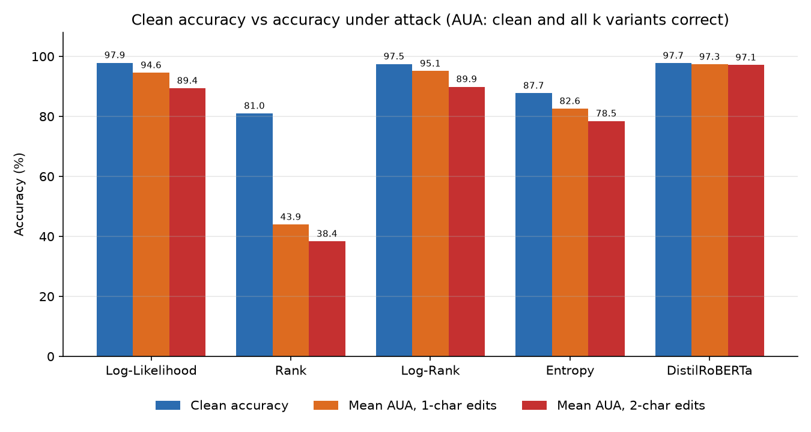

# AI-Text-Flagger

**AI-generated text detection using zero-shot statistical and fine-tuned transformer detectors.**

AI-Text-Flagger estimates whether an English text was written by a person or generated by a large
language model such as ChatGPT. It builds and compares two families of detectors: zero-shot detectors
that score a text with a language model's token statistics (GPT-2 log-likelihood, rank, log-rank,
entropy, and Fast-DetectGPT with Qwen2.5-0.5B) and a fine-tuned DistilRoBERTa classifier, trained on
HC3 and MAGE and tested on four test sets, including texts from 2025-26 models it has never seen.
Following the robustness survey it is based on, every detector is re-tested on typo-perturbed copies
of the test set and the accuracy under attack is reported next to the clean accuracy. A local
Gradio web app combines one detector of each kind and shows a probability, whether the detectors
agree and the known limitations, rather than a bare verdict.

## Team and course

- **Course:** CSET312 AI/ML mini-project, School of Computer Science Engineering and Technology,
  Bennett University, Greater Noida (December 2026)
- **Team:** Vartika Manish (S24CSEU0169), Vedansh Gupta (S24CSEU0173)
- **Mentor:** Himanshu Sharma

## Base paper

X. Liu, Y. Li and K. Li, "Enhancing the Robustness of AI-Generated Text Detectors: A Survey",
*Mathematics* 13(13), 2145, 2025. [doi:10.3390/math13132145](https://doi.org/10.3390/math13132145)

## Version 2 (October 2026): what changed and why

Version 1 (12-13 Oct 2026) was trained and tested on HC3 only (ChatGPT answers to questions, 2022/23).
It was 97-98 % accurate there, but in the demo a descriptive paragraph written by a current model was
labelled *Likely human-written* with 0 % - text unlike HC3 was out of distribution. Version 2 makes
three changes and measures the effect on text the detectors never saw in training:

1. **More varied training data - MAGE** (`src/mage.py`). 9,000 MAGE texts (10 writing domains:
   stories, opinion essays, reviews, news, scientific writing, ...; 27 generators: GPT, LLaMA, OPT,
   T5/FLAN, BLOOM, GLM, ...) are added to the 4,500 HC3 training texts. DistilRoBERTa is retrained on
   all 13,500.
2. **A stronger zero-shot detector - Fast-DetectGPT** (`src/fast_detect.py`, Bao et al., ICLR 2024)
   with a 2024 scoring model (Qwen2.5-0.5B) replaces GPT-2 log-likelihood in the web app.
3. **Tests on unfamiliar text.** Besides the HC3 test set: a MAGE in-distribution test set, MAGE's
   out-of-distribution set (four unseen domains, texts from GPT-4, an unseen generator) and a new
   **Modern AI** set (`src/modern_set.py`): 150 human MAGE texts paired with same-genre, same-topic,
   same-length texts written by `qwen/qwen3.8-27b` and `openai/gpt-oss-20b` via the free Groq API.
   Every detector of v1 (archived in `v1/`) and v2 is scored on all four sets (`python -m src.evaluate --sets`).

The v1 models, results, data and source code are kept in `v1/` (`v1/models`, `v1/results`,
`v1/data`, `v1/code/src`), so the comparison can be repeated. Results: see
[Results of version 2](#results-of-version-2).

## How it works

```
HC3 all.jsonl --+--> data.py --> train / val / test (+ test_mage, test_ood) --+--> zero_shot.py   --> models/zero_shot.json
MAGE (mage.py) -+   (normalise, clean, split)                                  +--> fast_detect.py --> models/fast_detect.json --+
                                                                               +--> finetune.py    --> models/distilroberta/   --+
Groq API --> modern_set.py --> data/test_modern.csv                                                                            |
                                                                                                                               v
   evaluate.py: --clean (HC3 test) | --sets (4 test sets, v1 vs v2) | --robust (perturb.py, k = 10) --> results/               |
                                                                            app.py (Gradio) <-- DistilRoBERTa + Fast-DetectGPT --+
```

**Fast-DetectGPT (v2 zero-shot detector, the one used by the web app).** The text (first 256 tokens)
is read once by Qwen2.5-0.5B (fp16). At every position the detector compares the log-probability of
the actual token with the log-probability the model *expects* for its own choices there:
`score = (sum ll_t - sum mu_t) / sqrt(sum var_t)`, where `mu_t` and `var_t` are the mean and variance
of `log q` under the model's distribution `q` (the analytic criterion of Bao et al.). Machine text
stays close to the model's preferred choices (high score); human text does not. A 1-D logistic
calibration fitted on the training split turns the score into P(AI). The scoring model and window
were chosen on the validation split (`results/fast_detect_model_selection.md`: Qwen2.5-0.5B/256
tokens was as accurate as 512 tokens or Qwen2.5-1.5B and the fastest, about 16 texts/s).

**Zero-shot detectors (GPT-2, report Algorithms 1-2).** Each text is truncated to 512 tokens and
passed once through GPT-2 (124 M parameters, fp16 on the GPU). For every token we record its
log-probability, its rank in GPT-2's predicted distribution (1 = most likely) and the entropy of that
distribution, and average them into four scores. AI text tends to have a higher log-likelihood and a
lower rank, log-rank and entropy. A one-dimensional logistic regression per score (fitted on the
standardised training scores, stored as plain JSON) turns a score into P(AI). The score with the best
validation F1 is the one used by the web app; a tie goes to the score listed first (log-likelihood,
rank, log-rank, entropy - `ZS_METRICS` in `src/config.py`).

**Fine-tuned detector (DistilRoBERTa, report Algorithm 3).** In v2 it is trained on 13,500 texts
(4,500 HC3 + 9,000 MAGE). `distilroberta-base` with a two-class
head, trained with a plain PyTorch loop: AdamW (learning rate 2e-5, weight decay 0.01), linear
schedule with 10 % warm-up, 3 epochs, batch size 8, first 256 tokens, fp16 autocast with gradient
scaling. The epoch with the best validation F1 is kept. One addition to report Algorithm 3: the
gradient norm is clipped at 1.0 before each optimiser step (`FT_GRAD_CLIP_NORM` in `src/config.py`,
the Hugging Face Trainer default; `--grad-clip 0` turns it off). At inference a text is split into
consecutive 256-token chunks (at most 8) and P(AI) is averaged over the chunks; when a text needs
more than one chunk, the last chunk is aligned to the end of the text so that every chunk is a full
256-token window (a tail of a few tokens would otherwise count as much as a full chunk).

**Robustness evaluation (report Algorithm 4, survey Section 7.1).** For every test text, each of four
character-level operations of Pruthi et al. (swap two neighbouring letters, drop a letter, replace a
letter with a neighbouring QWERTY key, add a random letter) and each level (1 or 2 edited words, one
edit per word, first letter kept), k = 10 reproducible variants are generated. A test sample counts
as correct only if **all** k variants are classified correctly; the resulting share is the
**accuracy under attack (AUA)**. As in the standard definition of AUA, a text whose clean
prediction is already wrong also counts as not robust (the original is the unedited variant), so
AUA can never exceed the clean accuracy. The mean per-variant accuracy is reported as well.

**Web app (report Algorithm 5).** The input is normalised exactly like the training data. If the
fine-tuned (DistilRoBERTa) and the zero-shot (v2: Fast-DetectGPT; v1: GPT-2 log-likelihood)
probability are on the same side of 0.5 the verdict is *Likely
AI-generated* or *Likely human-written* with the mean probability; otherwise it is *Uncertain –
review manually*. Texts under 20 words are flagged as less reliable. A text of fewer than two
tokens (e.g. one short word without punctuation, such as `Hello`) has no zero-shot score, so the
detectors cannot be compared and the verdict is *Uncertain* with a note. The pasted text is never
stored or logged, and the server only listens on 127.0.0.1.

## Setup

Python 3.12 on Windows 11 with an NVIDIA GPU (developed on an RTX 2050, 4 GB). A CPU also works, but
training and the robustness run are much slower.

```bash
python -m venv .venv                       # or: uv venv
.venv\Scripts\activate                     # Linux/macOS: source .venv/bin/activate
uv pip install torch --index-url https://download.pytorch.org/whl/cu128
uv pip install -r requirements.txt
```

(In a venv made with `python -m venv`, plain `pip install ...` works the same way as
`uv pip install ...`. A venv made with `uv venv` contains no pip, so keep using `uv pip install ...`
there, or create it with `uv venv --seed`.) The first run downloads `gpt2`, `distilroberta-base` and
`Qwen/Qwen2.5-0.5B` (about 1 GB) from the Hugging Face Hub, HC3's `all.jsonl` (74 MB) if it is not
already at `data/raw/all.jsonl` (or in the shared cache `~/.cache/hc3/all.jsonl`), and the MAGE CSV
files (about 600 MB) if they are not in `data/raw/mage/` or `~/.cache/mage/`.

Building the Modern AI test set needs a free Groq API key in an env file (`GROQ_API_KEY=...`, never
committed - `.env` is git-ignored) and the packages `python-dotenv` and `openai`. The generated set is
cached in `data/raw/modern_cache.jsonl`, so a rebuild makes no API calls.

## Pipeline commands

Run everything from the repository root:

```bash
python run_pipeline.py                     # full pipeline: data -> zero-shot -> fast-detect -> fine-tune -> clean -> sets -> robust -> app check
python run_pipeline.py --smoke             # tiny end-to-end check in smoke/ (64 rows per split, 1 epoch, k = 2)
python run_pipeline.py --skip-data --skip-zero-shot --skip-fast-detect --skip-finetune --skip-clean --skip-sets   # resume: robustness + app
python run_pipeline.py --limit 500 --k 3 --work-dir runs/small                     # a reduced run in its own folder
```

**Where the outputs go.** The full-size run writes `data/`, `models/` and `results/`; the Results
section below and the app's *Model report* tab come from these files. `--smoke` works in its own
folder `smoke/` (`smoke/data`, `smoke/models`, `smoke/results`; git-ignored), so it never replaces
them. Its numbers are meaningless: after one epoch on 64 rows DistilRoBERTa may still predict a single
class (in our smoke run accuracy 50 % and F1 0, so most AI texts got *Uncertain* in the smoke verdict
table); this is expected and not a broken build. Any other reduced run (`--limit`, another `--k` or
`--epochs`) is refused unless it names its own folder with `--work-dir DIR` (git-ignored under
`runs/`). The single modules below follow the same rule: a run with `--limit`, other epochs, another
`--k` or a subset of `--detectors` must name its output (`--data-dir`, `--output`, `--output-dir`,
`--results-dir`); naming the default folder explicitly overwrites it on purpose.

Or step by step (every module has `--help`; `src.data`, `src.zero_shot`, `src.finetune` and
`src.evaluate` also take `--limit N` for a fast run):

```bash
python -m src.data [--hc3-path data/raw/all.jsonl] [--no-mage]   # data/train.csv, val.csv, test.csv, test_mage.csv, test_ood.csv, summary.json
python -m src.modern_set --env-file PATH/.env                     # data/test_modern.csv (Groq; optional, cached)
python -m src.zero_shot [--batch-size 8]                          # models/zero_shot.json (+ results/cache/)
python -m src.fast_detect                                         # models/fast_detect.json (+ results/cache/fd_scores_*.csv)
python -m src.finetune [--epochs 3] [--batch-size 8]              # models/distilroberta/ + training_log.json (--grad-clip 1.0)
python -m src.evaluate --clean                                    # results/clean_metrics.csv/.md, clean_predictions.csv, verdict_metrics.csv
python -m src.evaluate --sets                                     # results/test_sets.md, test_sets_metrics.csv, test_sets_verdicts.csv (v1 vs v2)
python -m src.evaluate --robust [--k 10]                          # results/robustness*.csv/.md/.png
python -m src.evaluate --all                                      # all three
python -m src.evaluate --robust --k 2 --detectors loglik,distilroberta --results-dir runs/k2   # reduced run, own folder
python -m src.app [--port 7860] [--share false]                  # web app on http://127.0.0.1:7860
python -m src.app --dry-run                                       # build the UI and time one detection, no server
cd v1/code && python -m src.app --models-dir ../models --results-dir ../results --data-dir ../data   # the v1 app
python -m pytest -q                                               # tests (no GPU, network or API key needed)
```

GPT-2 statistics are cached in `results/cache/` (`<work dir>/results/cache/` for `--smoke` and
`--work-dir`), keyed by text id and a checksum of model, length limit and text, so interrupted or
repeated runs resume instead of starting over. A row cut off by an interrupted run is dropped and
recomputed.

### Runtime on an RTX 2050 (4 GB)

**Version 2** (26 Oct 2026; the CPU was limited to 4 of 8 cores at below-normal priority during
fine-tuning and evaluation, so these are upper bounds):

| Step | Work | Measured time |
|:---|:---|---:|
| data | HC3 + 319 k MAGE rows: normalise, trim, sample | ~12 min |
| zero-shot | GPT-2 statistics for 16,500 texts | ~11 min ¹ |
| fast-detect | Fast-DetectGPT scores for 16,500 texts (~12 texts/s) | ~25 min |
| finetune | 3 epochs x 1,688 batches + validation | 43 min |
| clean + sets | HC3 test + 3 more test sets, v1 and v2 detectors | ~27 min |
| modern set | 150 Groq generations at 20 requests/min (once; cached) | ~28 min |

¹ partly cached from an interrupted run. Robustness (k = 10) has not been re-run for v2: Fast-DetectGPT
on 120,000 variants needs about 3 hours on this GPU.

**Version 1:**

Measured in the full run of 12-13 Oct 2026 (compute time from the run logs, without the pause of the
interrupted robustness step described under Results):

| Step | Work | Measured time |
|:---|:---|---:|
| data | read 85 k answers, normalise, split | ~1 min ¹ |
| zero-shot | GPT-2 statistics for 6,500 texts (62-66 texts/s) | ~2 min |
| finetune | 3 epochs x 563 batches (~5 batches/s) + validation | 5.5 min |
| clean evaluation | 1,500 test texts (GPT-2 statistics already cached) | < 1 min |
| robustness | 120,000 variants: GPT-2 (~30 min, ~65 texts/s) + DistilRoBERTa (~25 min) | ~1 h |
| app check | build the UI and time one detection | ~5 s |

¹ Timed in smoke runs (30-60 s), which read and normalise the same 85 k answers.

The full pipeline therefore needs about 65 minutes of GPU time; `--smoke` takes 1-2 minutes, about
half of it in the data step. A laptop GPU's speed also depends on its power and thermal state.

## Results of version 2

Run of 26 Oct 2026 (RTX 2050, seed 42). Training: 13,500 texts (4,500 HC3 + 9,000 MAGE), validation
1,500 (500 + 1,000). All tables are in `results/test_sets.md` (and the app's *Model report* tab).

| Test set | Texts | What is unfamiliar about it |
|:---|---:|:---|
| HC3 test | 1,500 | nothing (same source as v1's training data) |
| MAGE test | 2,000 | nothing for v2 (same 10 domains / 27 generators as the MAGE training texts); new for v1 |
| MAGE OOD | 1,554 | 4 domains absent from training (CNN, IMDB, PubMed, DialogSum) and an unseen generator (GPT-4) |
| Modern AI | 299 | texts from 2025-26 models (Qwen3.8-27B, gpt-oss-20b), same genre/topic/length as the human texts |

**Accuracy (%)** at P(AI) >= 0.5:

| Detector | HC3 test | MAGE test | MAGE OOD | Modern AI |
|:---|---:|---:|---:|---:|
| DistilRoBERTa v1 (HC3 only) | 97.73 | 63.15 | 76.06 | 54.85 |
| Log-Likelihood v1 (HC3 calibration) | 97.87 | 63.25 | 67.31 | 50.50 |
| Log-Likelihood (v2 calibration) | 88.20 | 63.80 | 70.14 | 58.19 |
| Rank | 70.53 | 61.35 | 65.51 | 68.90 |
| Log-Rank | 87.27 | 64.40 | 69.88 | 55.85 |
| Entropy | 83.27 | 62.60 | 61.52 | 49.16 |
| Fast-DetectGPT | 81.60 | 57.90 | 68.47 | 66.22 |
| **DistilRoBERTa v2 (HC3 + MAGE)** | 90.73 | **85.10** | 75.93 | **70.23** |

**AUROC (%)** (threshold-free):

| Detector | HC3 test | MAGE test | MAGE OOD | Modern AI |
|:---|---:|---:|---:|---:|
| DistilRoBERTa v1 (HC3 only) | 99.96 | 66.89 | 85.38 | 64.80 |
| Log-Likelihood (GPT-2) | 99.59 | 66.42 | 78.26 | 64.03 |
| Rank | 91.25 | 67.13 | 72.13 | 75.50 |
| Log-Rank | 99.63 | 68.00 | 77.63 | 59.93 |
| Entropy | 95.04 | 65.32 | 62.72 | 50.67 |
| Fast-DetectGPT | 93.33 | 60.26 | 75.41 | 73.55 |
| **DistilRoBERTa v2 (HC3 + MAGE)** | 99.78 | **94.68** | **90.26** | **77.99** |

**Web app verdict before (v1) and after (v2), %** - the same agreement rule (Algorithm 5) in both:

| Test set | Version | Coverage | Accuracy (decided) | AI texts caught | Human texts wrongly flagged |
|:---|---:|---:|---:|---:|---:|
| HC3 test | v1 | 96.53 | 99.52 | 98.00 | 0.93 |
| HC3 test | v2 | 81.40 | 94.43 | 93.33 | 9.07 |
| MAGE test | v1 | 83.00 | 65.90 | 27.00 | 1.70 |
| MAGE test | v2 | 59.70 | 86.01 | 48.90 | 12.30 |
| MAGE OOD | v1 | 74.77 | 79.00 | 53.47 | 15.51 |
| MAGE OOD | v2 | 67.31 | 82.98 | 72.01 | 23.13 |
| Modern AI | v1 | 87.63 | 53.05 | 4.03 | 3.33 |
| Modern AI | v2 | 65.89 | 77.66 | 39.60 | 9.33 |

**Reading the results.**

- **The v1 failure is confirmed and measured.** On the Modern AI set v1 labelled only 4 % of the AI
  texts as AI (it called almost all of them human), and its accuracy was at chance (54.9 % for
  DistilRoBERTa, 50.5 % for GPT-2 log-likelihood).
- **MAGE training data helped most.** DistilRoBERTa v2 is the best detector on every unfamiliar set:
  MAGE test 63 -> 85 % accuracy, Modern AI 55 -> 70 % (AUROC 65 -> 78 %), MAGE OOD AUROC 85 -> 90 %.
  The app now catches 40 % of the modern AI texts instead of 4 %, and is right on 78 % of the texts it
  decides (53 % before).
- **Fast-DetectGPT** is better than every GPT-2 score on the Modern AI set (AUROC 73.6 vs 50.7-64.0,
  apart from Rank at 75.5) but weaker than DistilRoBERTa v2 everywhere; on MAGE's own data it is weak
  (60 % AUROC), as the MAGE paper reports for zero-shot detectors. Its value is as an independent second
  opinion: it disagrees with DistilRoBERTa on many human texts, which turns false accusations into
  *Uncertain*.
- **The cost is precision on HC3 and more false positives.** v2's DistilRoBERTa ranks HC3 texts almost
  as well (AUROC 99.8 %) but, at the 0.5 threshold, labels more human answers as AI (HC3 accuracy
  97.7 -> 90.7 %), and the app wrongly flags 9-12 % of human texts on HC3, MAGE and Modern AI
  (1-3 % in v1) and 23 % on MAGE OOD (16 % in v1). It also gives fewer verdicts (more *Uncertain*).
  Generalising to many kinds of AI text made the detector more willing to say "AI"; for a tool whose
  errors can hurt people this is the main open problem (a higher threshold or calibrating per domain
  would trade caught AI texts for fewer false accusations).
- **Still far from solved.** Even v2 misses 60 % of the modern AI texts and the best AUROC on them is
  78 %: detectors trained on older generators generalise only partly to new models, in line with the
  survey's discussion of cross-model robustness.

## Results of version 1

<!-- RESULTS -->
The tables in this section are the v1 results (HC3 only); their files are in `v1/results/`. The
robustness files in `results/` are also still the v1 run.

Full run on 12-13 Oct 2026 (RTX 2050, seed 42): 4,500 training / 500 validation / 1,500 test texts from HC3 English,
question-disjoint and balanced. Command: `python run_pipeline.py --hc3-path ~/.cache/hc3/all.jsonl` (without the
option the pipeline falls back to the same file while `data/raw/all.jsonl` is missing). The run was interrupted in the
robustness step, after all GPT-2 statistics of the variants had been cached, and was resumed with
`python run_pipeline.py --skip-data --skip-zero-shot --skip-finetune --skip-clean`, which reused the cached GPT-2
statistics, scored the variants with DistilRoBERTa, wrote the robustness files and ran the app check. All files are in
`results/`; the web app's *Model report* tab shows the same tables and the chart.

**Clean test set (1,500 texts, %).** Zero-shot score chosen for the app by validation F1: **Log-Likelihood**, tied
with Log-Rank (validation accuracy 97.2 %, F1 0.972 for both; a tie goes to the first score in `ZS_METRICS` order).
DistilRoBERTa: best epoch 3 of 3 (validation F1 0.982), fine-tuning took 5.5 minutes.

| Detector | Accuracy | Precision (human) | Precision (AI) | Recall (human) | Recall (AI) | F1 | AUROC |
|:---|---:|---:|---:|---:|---:|---:|---:|
| Log-Likelihood | 97.87 | 97.99 | 97.74 | 97.73 | 98.00 | 97.87 | 99.59 |
| Rank | 81.00 | 86.50 | 76.94 | 73.47 | 88.53 | 82.33 | 91.25 |
| Log-Rank | 97.47 | 97.59 | 97.34 | 97.33 | 97.60 | 97.47 | 99.63 |
| Entropy | 87.73 | 89.09 | 86.47 | 86.00 | 89.47 | 87.94 | 95.04 |
| DistilRoBERTa | 97.73 | 100.00 | 95.66 | 95.47 | 100.00 | 97.78 | 99.96 |

**Web app verdict (Algorithm 5: DistilRoBERTa and Log-Likelihood must agree, otherwise *Uncertain*), %.**
"Labelled AI" for human texts is the false-accusation rate.

| Group | Texts | Coverage | Accuracy (decided) | Labelled AI | Labelled human | Uncertain |
|:---|---:|---:|---:|---:|---:|---:|
| All texts | 1500 | 96.53 | 99.52 | 49.47 | 47.07 | 3.47 |
| Human texts | 750 | 95.07 | 99.02 | 0.93 | 94.13 | 4.93 |
| AI texts | 750 | 98.00 | 100.00 | 98.00 | 0.00 | 2.00 |

**Robustness: accuracy under attack, AUA (%).** A text counts only if its clean prediction and all k = 10 perturbed
variants are correct (1 or 2 words edited per variant).

| Detector | Normal | Swap 1 | Swap 2 | Drop 1 | Drop 2 | Add 1 | Add 2 | Key 1 | Key 2 |
|:---|---:|---:|---:|---:|---:|---:|---:|---:|---:|
| Log-Likelihood | 97.87 | 94.40 | 89.33 | 95.13 | 90.87 | 94.20 | 88.47 | 94.47 | 88.80 |
| Rank | 81.00 | 45.73 | 38.13 | 48.33 | 41.07 | 40.60 | 36.60 | 41.13 | 37.60 |
| Log-Rank | 97.47 | 95.27 | 90.00 | 95.60 | 91.67 | 94.67 | 88.67 | 94.87 | 89.20 |
| Entropy | 87.73 | 82.60 | 78.60 | 83.13 | 79.67 | 82.53 | 78.07 | 82.07 | 77.47 |
| DistilRoBERTa | 97.73 | 97.33 | 97.20 | 97.33 | 97.20 | 97.40 | 97.00 | 97.27 | 97.07 |

**Mean per-variant accuracy (%).**

| Detector | Normal | Swap 1 | Swap 2 | Drop 1 | Drop 2 | Add 1 | Add 2 | Key 1 | Key 2 |
|:---|---:|---:|---:|---:|---:|---:|---:|---:|---:|
| Log-Likelihood | 97.87 | 96.62 | 93.13 | 96.93 | 93.97 | 96.30 | 92.07 | 96.47 | 92.40 |
| Rank | 81.00 | 79.03 | 71.67 | 80.06 | 74.87 | 75.30 | 65.39 | 76.97 | 67.96 |
| Log-Rank | 97.47 | 97.03 | 93.94 | 97.13 | 94.98 | 96.74 | 93.11 | 96.88 | 93.49 |
| Entropy | 87.73 | 87.27 | 86.53 | 87.31 | 86.69 | 87.35 | 86.45 | 87.17 | 86.21 |
| DistilRoBERTa | 97.73 | 98.46 | 98.83 | 98.38 | 98.82 | 98.59 | 98.89 | 98.47 | 98.85 |



**Reading the results.**

- On clean text the GPT-2 Log-Likelihood and Log-Rank scores (97.9% / 97.5%) are as accurate as the fine-tuned
  DistilRoBERTa (97.7%); Rank (81.0%) and Entropy (87.7%) are weaker, the same ordering as the survey's Table 5.
- Typos hurt the zero-shot scores: with two edited words per variant their AUA falls by about 6-10 points
  (Log-Likelihood 97.9 -> 88.5-90.9, Log-Rank 97.5 -> 88.7-91.7, Entropy 87.7 -> 77.5-79.7) and Rank collapses
  to 36.6-41.1%. DistilRoBERTa stays at 97.0-97.4%.
- Our attack is milder than the survey's: we score k = 10 random variants per text, the survey (following
  Pruthi et al.) perturbs every word, so its AUA numbers are lower (e.g. RoBERTa 87.4% under 2-character swaps).
  Compare the direction of the effects, not the exact values.
- DistilRoBERTa's per-variant accuracy is slightly higher than its clean accuracy: all of its clean errors are human
  texts labelled AI, and typos make text look more human. Typos are therefore not an attack on this model in HC3,
  but they do mean that typo-free human writing is the hardest case for it.
- The app's agreement rule gives a verdict on 96.5% of texts, is right on 99.5% of those, and wrongly labels 0.93%
  of human texts as AI. These numbers hold for HC3-style text; new topics, newer AI models and human-edited AI text
  (not tested here) are expected to be harder (see Limitations).
<!-- /RESULTS -->

Targets from the report (Table 1): fine-tuned detector >= 95 % accuracy and F1 >= 0.95, best
zero-shot detector >= 90 % accuracy, best detector's 1-character accuracy within 5 percentage points
of its clean accuracy, and a verdict for a 300-word text in under 2 seconds. v1 met all of them on HC3;
v2 trades HC3 accuracy (90.7 %) for much better accuracy on unfamiliar text (see above).

## Project structure

```
AI-Text-Flagger/
├── README.md
├── requirements.txt         # Python dependencies (install torch from the CUDA index first)
├── run_pipeline.py          # runs all steps in order (--smoke, --skip-*, --work-dir)
├── pytest.ini
├── data/                    # generated: raw/, train/val/test.csv, test_mage.csv, test_ood.csv, test_modern.csv, summary.json
├── models/                  # generated: zero_shot.json, fast_detect.json, distilroberta/
├── v1/                      # version 1 archive: code/src, models/, results/, data/ (for the before/after comparison)
├── results/                 # generated: metrics/robustness CSV + Markdown, chart, cache/
├── logs/                    # console logs of the full run (local only, git-ignored)
├── smoke/, runs/            # generated by --smoke / other reduced runs: own data/, models/, results/ (git-ignored)
├── src/
│   ├── config.py            # all constants: seed 42, split sizes, model names, lengths, paths
│   ├── base.py              # BaseDetector interface (fit / predict_proba / predict), seeding, device
│   ├── text_utils.py        # normalize_text(), word_count()
│   ├── data.py              # HC3DataModule: download, clean, split (+ MAGE splits)
│   ├── mage.py              # MAGE loader: label flip, artefact removal, balanced domain sampling
│   ├── modern_set.py        # Modern AI test set via the Groq API (cached)
│   ├── zero_shot.py         # ZeroShotDetector: GPT-2 token statistics + calibration
│   ├── fast_detect.py       # FastDetectGPTDetector: Fast-DetectGPT criterion (Qwen2.5-0.5B) + calibration
│   ├── finetune.py          # FineTunedDetector: DistilRoBERTa training and chunked prediction
│   ├── perturb.py           # Perturber: swap / drop / key / add
│   ├── evaluate.py          # Evaluator: clean, test-set (v1 vs v2) and robust metrics, tables, chart
│   └── app.py               # DetectorApp (Gradio) + Verdict and the decision rule
└── tests/                   # pytest (241 tests): normalisation, data splits, MAGE loader, perturbations,
                             # metrics, zero-shot and Fast-DetectGPT maths, chunking, decision rule, UI
```

## Data: licence and normalisation

The detectors use the English HC3 corpus (Guo et al., 2023), `all.jsonl` from
[Hello-SimpleAI/HC3](https://huggingface.co/datasets/Hello-SimpleAI/HC3), licensed
**CC-BY-SA-4.0**. The data is downloaded at run time and is not redistributed in this repository.

- Each answer becomes one row (label 0 = human, 1 = ChatGPT); the question id is the line index in
  `all.jsonl`. Empty texts, texts with fewer than 20 words and exact duplicates are removed.
- Splits are made **by question** (seed 42): about 70 % / 10 % / 20 % of the questions form the
  train / validation / test pools, from which balanced samples of 4,500 / 500 / 1,500 texts are drawn,
  preferably one human and one ChatGPT answer of the same question. No question is in two splits;
  `data/summary.json` reports counts per split, class and source, median lengths and a disjointness check.
- **Normalisation.** HC3's human answers are pre-tokenised (77 % contain `" . "`, 72 % `" , "`,
  34 % `" n't"`; 0 % of ChatGPT answers do), while 30 % of ChatGPT answers contain line breaks. A
  detector would learn these artefacts instead of writing style, so every text of both classes - in
  training, testing and in the app - passes through the same `normalize_text()`: typographic quotes to
  ASCII, line breaks to spaces, no space before closing punctuation or after opening brackets,
  re-attached contractions (`do n't` -> `don't`), tightened hyphens (`oscar - winning`), double quotes
  (`" Best Seller "`, only for properly delimited pairs, so `a 12" pizza` is left alone) and `# 1`,
  collapsed whitespace. Measuring the corpus after these rules showed further human-only artefacts,
  so the same function also removes HC3's anonymised link placeholders (`[source] (URL_0)` ->
  `source`; 12 % of human vs 0.1 % of ChatGPT answers), re-joins words the tokeniser split
  (`can not` -> `cannot`, `gon na` -> `gonna`) and tightens `$ 5`, `AC / DC`, spaced single quotes
  (`' truth '`, `friends ' car`) and spaced markdown emphasis (`* very *`). `summary.json` reports
  the rate of each of these artefacts per class after normalisation - over the split rows and over
  the whole cleaned corpus; all are below 2 % (checked by a test).

**MAGE (v2).** MAGE (Li et al., 2024; [yaful/MAGE](https://huggingface.co/datasets/yaful/MAGE),
**Apache-2.0**) is also downloaded at run time. MAGE labels 1 = human, 0 = machine; the loader flips them
to the project's 0 = human, 1 = AI. Every MAGE text goes through the same `normalize_text()` and
two MAGE-specific clean-ups, because measurement showed class-specific artefacts: the Reddit CMV
moderator footer (human only) is removed, and texts that stop mid-sentence (18.5 % of machine vs 5 % of
human texts - cut-off generations) are trimmed to their last complete sentence; texts that still end
mid-sentence are dropped for both classes (`summary.json` -> `mage`: 0 % of either class end without
punctuation afterwards). Training/validation/test samples are balanced per class and spread evenly over
the 10 domains (900 training texts per domain); the OOD set is used complete (1,554 texts).

**Modern AI test set (v2).** Human side: MAGE *test* texts of 80-400 words in six genres (stories,
opinion essays, reviews, scientific abstracts, news, explanations) not used in `test_mage.csv`. AI
side: one text per human text, same genre and length, topic given by the first 60 words as a hint
("do not copy"), temperature 0.7. MAGE's human texts are pure ASCII, so the AI texts are folded to
ASCII the same way (em-dash -> ` - `, `café` -> `cafe`); otherwise any such character would give the
label away. Median length: 199 (human) vs 206 (AI) words.

## Limitations

- **A probability, not proof.** Scores support a human decision; they never establish authorship.
- **Training distribution.** v1 saw only HC3 (ChatGPT 2022/23 answers to questions) and failed on
  other kinds of AI text (4 % caught on the Modern AI set). v2 adds MAGE (10 domains, 27 generators up
  to GPT-3.5/LLaMA-1) and catches 40 % there - better, but newer models, other genres and other
  languages remain partly out of distribution.
- **More false positives in v2.** The app wrongly flags 9-12 % of human texts (23 % on MAGE OOD)
  against 1-3 % in v1 (16 %); see Results of version 2.
- **Small Modern AI set.** 299 texts from two models; differences of a few points are within noise.
- **Length confound.** In HC3, ChatGPT answers are typically about twice as long as human answers
  (median 181 vs 85 words; 161 vs 102 over all v2 split texts, `median_words` in `summary.json`); part
  of what the detectors learn may be length-related. The Modern AI set is length-matched.
- **Typos, editing and paraphrasing.** Character perturbations lower accuracy (see the v1 robustness
  table; not yet re-run for v2); text edited by a person (hybrid text) and paraphrased AI text were not
  evaluated.
- **Fairness.** GPT detectors have been shown to flag non-native English writing more often
  (Liang et al., 2023); false positives can harm students.
- **Remaining markup.** Markup typed by the Reddit authors themselves is kept: asterisks (bullets
  and emphasis, about 10 % of human vs 0.3 % of ChatGPT answers), `> ` quote markers (2.1 % vs
  0.03 %) and ` -- ` dashes (2.0 % vs 0 %), measured over the 6,500 split texts
  (`markup_rates_after_normalisation` in `summary.json`); the detectors may partly rely on them.
- **GPT-2 window.** The zero-shot detectors read only the first 512 tokens, so a typo further into a
  long text is invisible to them while DistilRoBERTa (up to 8 x 256 tokens) sees it. The robustness
  table states how many test texts and variants this affects.
- **Short texts** (< 20 words) are accepted but flagged as less reliable; a text of a single GPT-2
  token (e.g. one short word without punctuation, such as `Hello`) has no zero-shot score and always
  gets *Uncertain*. A single word of two or more tokens (`Hello!`, `ChatGPT`) does get a zero-shot
  score and can get a definite verdict.
- The zero-shot statistics are computed with fp16 GPT-2 on the GPU; on a CPU (fp32) they differ
  slightly, which can move borderline probabilities.

## References

1. X. Liu, Y. Li and K. Li, "Enhancing the robustness of AI-generated text detectors: A survey," *Mathematics*, 13(13), 2145, 2025.
2. B. Guo et al., "How close is ChatGPT to human experts? Comparison corpus, evaluation, and detection," arXiv:2301.07597, 2023.
3. I. Solaiman et al., "Release strategies and the social impacts of language models," arXiv:1908.09203, 2019.
4. S. Gehrmann, H. Strobelt and A. M. Rush, "GLTR: Statistical detection and visualization of generated text," ACL System Demonstrations, 2019.
5. D. Pruthi, B. Dhingra and Z. C. Lipton, "Combating adversarial misspellings with robust word recognition," ACL, 2019.
6. V. Sanh, L. Debut, J. Chaumond and T. Wolf, "DistilBERT, a distilled version of BERT," arXiv:1910.01108, 2019.
7. Y. Liu et al., "RoBERTa: A robustly optimized BERT pretraining approach," arXiv:1907.11692, 2019.
8. A. Radford et al., "Language models are unsupervised multitask learners," OpenAI, 2019.
9. W. Liang et al., "GPT detectors are biased against non-native English writers," *Patterns*, 4(7), 2023.
10. T. Wolf et al., "Transformers: State-of-the-art natural language processing," EMNLP System Demonstrations, 2020.
11. Y. Li et al., "MAGE: Machine-generated text detection in the wild," ACL, 2024 (arXiv:2305.13242).
12. G. Bao, Y. Zhao, Z. Teng, L. Yang and Y. Zhang, "Fast-DetectGPT: Efficient zero-shot detection of machine-generated text via conditional probability curvature," ICLR, 2024.
13. E. Mitchell et al., "DetectGPT: Zero-shot machine-generated text detection using probability curvature," ICML, 2023.
14. Qwen Team, "Qwen2.5 technical report," arXiv:2412.15115, 2024.
